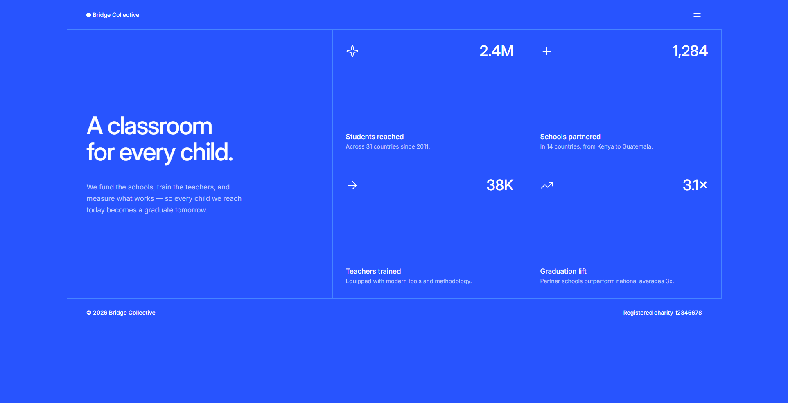

<h1 align="center">Grid landing page</h1>

Solution to the Frontend Mentor challenge

  

This is a solution to the [Grid landing page challenge on Frontend Mentor](https://www.frontendmentor.io/challenges/grid-landing-page). Frontend Mentor challenges help you improve your coding skills by building realistic projects.

## Screenshot

Desktop view (1920px wide)

## Built with

- HTML
- CSS
- JavaScript

## Links

- Solution URL: https://www.frontendmentor.io/solutions/grid-landing-page-KIwasVWaEl
- Live Site URL: https://grid-landing-page-abe.netlify.app

## Continued development

Later I will add trap focus inside the open menu, dynamically loading data from a JSON file, and counting stat numbers up from zero.

## Author

Find me on other platforms!

- Frontend Mentor: [@AverageBaguetteEnjoyer](https://www.frontendmentor.io/profile/AverageBaguetteEnjoyer)
- CodeWars: [AverageBaguetteEnjoyer](https://www.codewars.com/users/AverageBaguetteEnjoyer)
- Coddy: [@baguetteenjoyer](https://coddy.tech/user/baguetteenjoyer?via=share_profile)